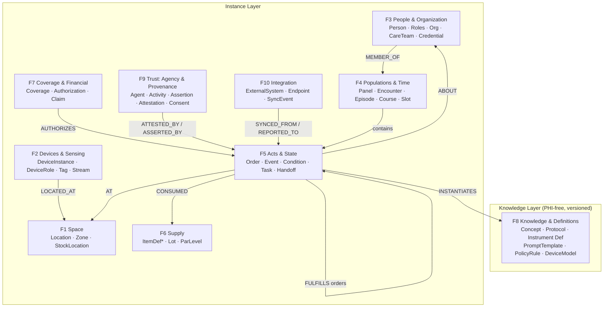

# The Weft Schema

**A unified graph schema for healthcare — clinical, facility, device, people, supply, financial, and AI-provenance in one metagraph.**

| | |
|---|---|
| **Version** | 0.1 (draft) · 2026-08 |
| **Publisher / steward** | Cleansheet LLC |
| **Status** | Public specification — open for citation and implementation |
| **License** | [CC BY 4.0](https://creativecommons.org/licenses/by/4.0/) (proposed; pending final legal review) |
| **Canonical home** | https://weftgraph.org |
| **DOI** | [`10.5281/zenodo.21806130`](https://doi.org/10.5281/zenodo.21806130) (concept DOI — resolves to the latest version) |
| **Machine projection** | A normative machine-readable projection accompanies this specification (`weft.json`) |
| **Cite as** | *The Weft Schema, v0.1.* Cleansheet LLC, 2026. https://weftgraph.org |

> **What Weft is.** Weft defines the node types, edge types, and modeling rules for representing everything a clinician's mental model actually touches — equipment, locations, people, clinical facts, money, supply, and AI reasoning; across hardware, software, and human (wetware) agents — as a single typed graph. The *weft* is the cross-thread that binds separate strands into one fabric; the schema binds five domains that are normally modeled in isolation into one metagraph.

---

## 1. Scope and Prior Art

Weft fuses five domains that the literature and industry model separately:

| Domain | Where it is usually modeled alone |
|---|---|
| Clinical acts & state | EHR / patient-journey graphs (e.g. patient-centric Neo4j models, OMOP CDM, openEHR) |
| People & organization | HR / directory systems; partial in EHR |
| Facility & space | Building ontologies (Brick, RealEstateCore, Project Haystack) |
| Device & sensing | Sensor ontologies (W3C SSN/SOSA), UDI registries, ISA-95 |
| Trust & AI-provenance | Provenance models (W3C PROV), audit logs, AI-transparency tags |

Biomedical knowledge graphs (Hetionet, PrimeKG, SPOKE, CKG) are knowledge-only; EHR graphs are patient-only; building ontologies are facility-only; configuration-management databases are IT-only. **We are not aware of a published schema that fuses all five domains in one metagraph.** Weft is an attempt at that fusion; this specification is published in part to establish it as prior art.

Every construct in Weft names its lineage in a recognized standard (see [§13](#13-standards-lineage)). The primitives are precedented; the combination is the contribution.

| Dimension | Value |
|---|---|
| Node families | 10 |
| Node types | 70 (closed catalog) |
| Edge types | 77 forward types (closed catalog with named inverses) + 1 monitored escape hatch |
| Standards lineage | FHIR R4/R5, W3C PROV, SOSA/SSN, Brick/RealEstateCore, SNOMED CT, ISA-95, GS1 UDI, OCEL 2.0 |

---

## 2. Design Principles

Eight rules govern every modeling decision. Each was independently converged on by multiple established standards, cited so the design is defensible.

**P1 — Two layers: knowledge and instance.** A versioned, PHI-free **knowledge layer** (terminology concepts, protocols, instrument definitions, prompt templates, policy rules, device models, building classes) and a mutable **instance layer** (patients, encounters, assets, readings, attestations), joined only by `INSTANTIATES` / `CODED_AS` / `MAPS_TO` edges. Never copy hierarchy into instances. *(Lineage: UMLS CUI join; ICD-11 Foundation→linearization; SPOKE's embed-don't-store; GS1 UDI DI/PI split. This is also what makes PHI-local segmentation natural.)*

**P2 — Reify when a relationship carries role, period, state, or signature — or must itself be referenced.** Then it is a node, not an edge. Direct edges may exist as *derived shortcuts* but are never the source of truth. *(Lineage: FHIR PractitionerRole / Provenance / DeviceAssociation; ISA-95 AssetAssignment; RTLS tag-subject association; PROV qualified relations.)*

**P3 — One event shape for everything observed.** A clinical vital, a room-temperature reading, an RTLS zone entry, and an equipment power-state change are all the same **Event** node shape: *who/what sensed it → what it's about → what property → what value → when → where*. FHIR Observation and W3C SOSA are structurally isomorphic; Weft exploits that. Raw high-rate streams stay in a time-series store; only semantic transitions materialize as graph nodes. *(Lineage: SOSA/SSN ≅ FHIR Observation, both descending from OGC O&M; Brick's graph-as-index pattern.)*

**P4 — Small, closed, directional edge vocabulary with named inverses, plus exactly one monitored escape hatch.** `RELATES_TO` exists for the unforeseen; accumulation there is the missing-schema-feature detector, reviewed on a cadence. *(Lineage: ServiceNow CSDM discipline; OMOP FACT_RELATIONSHIP as cautionary tale.)*

**P5 — Space, placement, and function are three separate edge families.** Static containment (`PART_OF`), things-placed-in-space (`LOCATED_AT`, always time-sliced because things move), and functional topology (`FEEDS`, `MONITORS`, `CONTROLS`, `DEPENDS_ON`). *(Lineage: Brick core relationships; FHIR `Location.partOf` + `operationalStatus`.)*

**P6 — Temporal validity everywhere; append-only corrections.** Every role, membership, association, and placement edge carries a validity interval; "current state" is a view over intervals, never an overwrite. Corrections are `SUPERSEDES` + new node, never deletion. Generation and attestation are distinct activities on the same version — so "what exists unattested?" is a single anti-join over `ATTESTED_BY`. *(Lineage: W3C PROV invalidation; FHIR version-specific Provenance targets.)*

**P7 — Authority is not relationship.** `RELATED_TO` (mother-of, spouse-of) is a social fact. `HAS_AUTHORITY_FOR` (consent, information access, pickup) is a separate, evidenced, scoped, revocable edge. Custody asymmetry, guardianship, adolescent carve-outs, and 42 CFR Part 2 all break if these are conflated.

**P8 — Segmentation is a schema property, not an application behavior.** Every node and edge carries `dataClass ∈ {clinical, administrative, personal, operational}`. The EHR-segmentation boundary composes over `dataClass`: clinical flows to FHIR write-back under governance; administrative (rosters, teams, schedules) and personal (preferences, family context) never do.

---

## 3. The Metagraph at a Glance

Ten node families.

The load-bearing pattern that recurs in every family is the **verb triple**:

> **Order** (intent) → **Event** (act) → **Attestation** (accountability)

Every clinical and operational verb in every setting is this triple with different policy packs attached: prescribe→administer→sign, order→collect→verify, request→transport→confirm, plan→count→witness.

---

## 4. Node Catalog

Conventions: PascalCase node types; every node has `id`, `type`, `dataClass`, `createdBy` provenance; *(FHIR analog)* noted where one exists. Setting-specific subtypes are listed in [§8](#8-setting-extension-model), not here — the core is setting-invariant.

### F1 — Space

| Node | FHIR analog | Notes |
|---|---|---|
| `Location` | Location | Recursive via `PART_OF`. `form` property uses the FHIR R5 vocabulary (site, building, wing, ward, level, corridor, room, bed, vehicle, house, cabinet, area, virtual) — a building vocabulary that goes down to *bed* and *vehicle*. `operationalState` (clean/dirty/occupied/blocked/in-service) is first-class: it gates bookability and drives the bed board |
| `RtlsZone` | Location profile (HL7 RTLS IG) | Kept distinct from Location because RF zones don't align 1:1 with rooms; `MAPS_TO` Location. Carries `certainty` (distance-based vs room-contained) — nurse-call routing requires certainty-based zones |
| `StockLocation` | — | Inventory-holding place, always `LOCATED_AT` a Location. **One type subsumes**: automated dispensing cabinet, med cart, crash cart, vaccine fridge, school med cabinet, controlled drawer, vehicle trunk, field-trip kit, patient home shelf. Differences are policy, not type |

The patient home is a `Location` the organization does not control — it carries hazard and access attributes (`dataClass: operational`) and can host StockLocations and DeviceInstances (durable medical equipment).

### F2 — Devices & Sensing (hardware)

The **three-way split** — model / role / physical instance — is non-negotiable; collapsing role into instance destroys swap history and location history.

| Node | FHIR analog | Notes |
|---|---|---|
| `DeviceModel` | DeviceDefinition | Knowledge-layer catalog entry, keyed by UDI-DI/GTIN. Recalls and maintenance strategies attach here |
| `DeviceRole` | — (ISA-95 Equipment role) | A functional slot: "infusion pump position, Room 214," "chair 2 device," "wing B kiosk." Persists while serial-numbered instances rotate through it |
| `DeviceInstance` | Device | Serial-numbered physical asset (UDI-DI + PI). `PART_OF` for component trees (IEEE 11073 MDS⊃VMD⊃Channel). Can be an **Agent** ([§7](#7-the-agent-trichotomy--hardware-software-wetware)) when it senses or acts |
| `Tag` | Device (RTLS IG profile) | RTLS/BLE/NFC tag. Never conflated with what it's attached to — tags get reused. An `Association` node binds tag↔subject with a validity period |
| `Association` | DeviceAssociation (R5) | The binding itself, kept as its own time-bound record: tag↔person, device↔patient (implanted/attached), asset↔role, telemetry-box↔patient — each with a start and end, so tag reuse and device swaps keep their history. The workhorse of P2 |
| `SensorStream` | DeviceMetric | Brick-style Point: a named measurable channel on a DeviceInstance (`temperature of fridge F-2`, `RSSI of gateway G-9`). Holds the reference into the time-series store; the graph indexes, the TSDB stores |

### F3 — People & Organization (human agents)

| Node | FHIR analog | Notes |
|---|---|---|
| `Person` | Person | One human, many roles; identity hub with assurance-weighted links. A nurse is also a patient somewhere |
| `Patient` | Patient | Role of a Person in an org's context. Subtypes by setting ([§8](#8-setting-extension-model)): Student, Resident |
| `Practitioner` | Practitioner | Employer-independent identity; credentials hang here |
| `PractitionerRole` | PractitionerRole | **Role-as-node**: person × org × location × specialty × period. All performance/ordering edges land here, not on Practitioner |
| `RelatedPerson` | RelatedPerson | Family/caregiver **as actor**. Mere reachability stays an attribute on Patient; promote to node the moment the person acts, consents, witnesses, or is trained (a `Credential` for the trained skill, with a competency `Attestation`) |
| `Organization` | Organization | Recursive via `PART_OF`: HealthSystem→Hospital→Department; District→School; Operator→Facility. Payers, pharmacies, agencies, courts are Organization subtypes |
| `OrganizationAffiliation` | OrganizationAffiliation | A relationship between two organizations, kept as its own record so it can carry its own dates and terms (non-hierarchical org↔org): networks, referral agreements, hospice overlay on a nursing facility |
| `CareTeam` | CareTeam | Encounter-scoped (code team, rapid response) or longitudinal (interdisciplinary team); members are roles or other teams, each with a coverage period |
| `Credential` | Practitioner.qualification | License/DEA/BLS/delegation-training/REMS-enrollment, with issuer, jurisdiction, expiry. Expiry drives Tasks |
| `VerificationResult` | VerificationResult | Primary-source verification **event** for a Credential — claim and verification are separate layers |

### F4 — Populations & Time Containers

Four distinct temporal containers (conflating them is the classic EHR failure) plus the population container:

| Node | FHIR analog | Notes |
|---|---|---|
| `Encounter` | Encounter | Bounded interaction, minutes–days, with a location trace (time-sliced `AT` edges) |
| `EpisodeOfCare` | EpisodeOfCare | Condition/program-scoped span owned by an org: home-health 60-day, wound episode, pregnancy, inpatient-rehab stay |
| `Course` | — | **Protocolized planned series** with plan-vs-actual semantics: a multi-session treatment protocol, an induction series, a chemo regimen, a PT plan, allergy shots, a vaccine series. Sessions are Encounters `IN_COURSE` with sequence numbers |
| `CareRelationship` | — | Open-ended longitudinal **state**: hasPCP, attributedTo (payer), enrolledIn (care-management/hospice), residesAt, rosteredAt. Effective-dated, multi-source (attribution disputes get one edge per source with provenance) |
| `Panel` | Group | **The non-clinical population container** — a signature primitive. One type serves: PCP panel, school roster, residential census, home-health caseload, sports team, screening cohort, employer population. `membershipBasis ∈ {rostered, attributed, assigned, resides, enrolled, teamMember}` does the differentiating. `dataClass: administrative` — a mental-model fact kept segmented from the EHR |
| `Schedule` / `Slot` / `Appointment` | same | Appointment `BOOKS` multiple Slots atomically (e.g. chair + device + technician). See BookableResource mixin, [§6](#6-mixins--conventions) |
| `WaitlistEntry` | — | Patient × serviceType × priority × offer events |
| `Shift` | — | Staffing time container: who is on, in what role, on what unit. Compliance properties (ratios, staffing quotas) are computed over the Shift, not the person |
| `Route` | — | Ordered visit/stop sequence with travel legs: home-health day, med-pass cart run, lab courier, transport job chains |

### F5 — Acts & State (the verbs)

| Node | FHIR analog | Notes |
|---|---|---|
| `Order` | ServiceRequest / MedicationRequest / DeviceRequest / SupplyRequest / NutritionOrder | Universal intent node. `BASED_ON` chains, `SUPERSEDES` for renewal/priorPrescription |
| `Event` | Observation / MedicationAdministration / Procedure / Specimen collection / ImagingStudy / SupplyDelivery | Universal act node (P3). Subtypes by verb, one shape: performer, subject/focus, code, value/outcome, time, location, device used, lots consumed. **Includes non-clinical events**: RTLS zone transition, temperature excursion, door alarm, environmental-services room turn, ADL completion, outdoor environmental / weather advisory (`ABOUT` a Location — the SOSA case: an external station observing a geographic feature) |
| `Condition` / `Allergy` | Condition / AllergyIntolerance | Clinical **state** nodes (not events): onset/abatement intervals, `EVIDENCED_BY` Events |
| `InstrumentResponse` | QuestionnaireResponse | Completed screening, assessment, or intake form; `INSTANTIATES` an InstrumentDefinition; scores are derived Events |
| `Task` | Task | Workflow step with owner, due, state machine; `input`/`output` slots carry AI-pipeline parameters naturally |
| `Handoff` | — (Communication + Task) | First-class: shift report, transfer, transport, referral, discharge are subtypes. `FROM`/`TO` roles or orgs, `REGARDING` patient or panel, `TRANSFERS_RESPONSIBILITY_FOR` open orders/tasks. Loop-closure is a state on the Handoff: a returned consult-note `Document` advances it to closed |
| `CountEvent` | — | **Verify-actual-vs-expected**, optionally two-party: controlled count, medication reconciliation, crash-cart seal check, blood verification, narcotic waste, pack-out/return, expiry sweep, blind re-count. Parameterized by policy pack, not subtyped per setting |
| `TransportRequest` | — | Moves Patient / Specimen / DeviceInstance / InventoryLot between Locations; legs, requirements (O2, monitor, RN accompany) |
| `Alert` | DetectedIssue | Care gap, critical result, threshold breach, remote-monitoring flag, telemetry alarm. Carries routing/escalation/acknowledgment edges — closed-loop by construction |
| `Communication` | Communication | Message, family update, fax (filed with provenance), portal thread, notification |
| `Document` | DocumentReference / Composition | Notes, plans, court orders (as *evidence* for authority edges), consents' paper trail |
| `IncidentReport` | — | Injury, variance, device event (feeds safety reporting), fall, unresolved count discrepancy |

### F6 — Supply

| Node | FHIR analog | Notes |
|---|---|---|
| `ItemDefinition` | Medication / DeviceDefinition / supply catalog | Knowledge-layer catalog: medication, vaccine, wound supply, PPE, blood product, dose form |
| `InventoryLot` | — | lot# + expiry + qty; `fundingSource ∈ {VFC, private, 340B, REMS}` (legally required segregation is a graph constraint); `OWNED_BY` Organization **or Patient** (school medication bottles, home DME) |
| `ParLevel` | — | ItemDefinition × StockLocation threshold; breach spawns a replenishment Task |

Cold chain is not a special system: a `SensorStream` `MONITORS` a `StockLocation`; a `TempExcursion` Event `QUARANTINES` lots pending disposition. The consumption edge (`Event —CONSUMED→ InventoryLot`) closes the loop from clinical act to inventory decrement to charge capture.

### F7 — Coverage & Financial

| Node | FHIR analog | Notes |
|---|---|---|
| `Coverage` | Coverage | Patient × Plan × subscriber × rank (coordination-of-benefits ordering) |
| `Plan` / `Payer` | InsurancePlan / Organization | Payer is an Organization subtype; networks are Organizations so membership reuses affiliation machinery |
| `EligibilityCheck` | CoverageEligibilityRequest | Point-in-time truth with staleness — an Event subtype |
| `Authorization` | — (prior auth) | `AUTHORIZES` Order / Course / Episode; unitsGranted, validity window; the request is backed by an evidence-bundle `Document` (`DERIVED_FROM` the supporting InstrumentResponses, failed trials, notes); reauth cycles are `SUPERSEDES` chains |
| `Claim` / `ClaimLine` | Claim | ClaimLine `BILLS` a Code and `SUPPORTED_BY` Attestations — **the billing-integrity edge: no attestation, no claim line** |
| `Payment` / `Remittance` | PaymentReconciliation | Copay at desk through remittance adjudication; denial → appeal chains |

### F8 — Knowledge & Definitions (PHI-free, versioned)

| Node | FHIR analog | Notes |
|---|---|---|
| `Concept` | CodeSystem concepts | Terminology binding targets (SNOMED/LOINC/RxNorm/ICD/local). Instance nodes point in via `CODED_AS`; subsumption (`IS_A`) and mapping (`MAPS_TO`) run here, never copied out. Per-concept computed-vs-asserted flag |
| `ProtocolDefinition` | PlanDefinition / ActivityDefinition | Order sets, treatment protocols, standing orders, screening cadences. `$apply`-style instantiation is itself a recorded Activity |
| `InstrumentDefinition` | Questionnaire | Screening and assessment instruments — versioned; validated translations only (never machine translation) |
| `PromptTemplate` | Library | **Prompts are content**: versioned, signed, governed. Every AI Activity `INSTANTIATES` the prompt version that governed it — "which prompt produced this?" is one edge |
| `PolicyRule` | — | Org-scoped rule that `GATES` a verb: witnessed dispensation, two-clinician blood check, restraint renewal cadence, self-carry authorization, staffing quota, REMS observation cadence. Policy packs compose down the org tree — **this is how many settings share one schema** |
| `DeviceModel` | DeviceDefinition | (Listed in F2; lives in the knowledge layer) |

### F9 — Trust: Agency, Consent & Provenance

The epistemological core. W3C PROV's trichotomy (Entity / Activity / Agent) is adopted wholesale; FHIR Provenance is its lossless export format.

| Node | FHIR analog | Notes |
|---|---|---|
| `Agent` (abstract) | Provenance.agent.who | Three concrete classes — **human/wetware** (PractitionerRole, RelatedPerson, Patient), **hardware** (DeviceInstance-as-sensor), **software** (SoftwareAgent). See [§7](#7-the-agent-trichotomy--hardware-software-wetware) |
| `SoftwareAgent` | Device (per HL7 AI Transparency IG) | A model version: an extraction model, a triage model, a decision-support reasoner, a route optimizer. Carries a model-card reference. Acts `ON_BEHALF_OF` an accountable Organization |
| `Activity` | Provenance (activity) | A bounded execution: extraction run, compile, pre-read, detector sweep, count session, sync job. `USED` inputs, `INSTANTIATES` its ProtocolDefinition/PromptTemplate, `INFORMED_BY` upstream activities |
| `Assertion` | resource + AI-transparency tag | An unattested claim produced by any agent: AI pre-read impression, extracted Condition candidate, detector finding, sensor-derived state. Assertions are quarantined from the EHR by construction |
| `Attestation` | Provenance + Signature | Human-only accountability act over a specific version: `mode ∈ {attest, verify, co-reason}`. Edit-is-attest. Per-item, never per-note |
| `Consent` | Consent | Scoped, versioned, revocable; grantor may ≠ patient; disclosure-scoped where 42 CFR Part 2 applies; hard-block gate semantics |
| `ConsentAuthority` | — | Who may decide for whom, kept as its own record: Person × Patient × `basis ∈ {self, parent, guardian, POA, court order}` × scope × restrictions × `EVIDENCED_BY` Document. **One type unifies** pediatric guardianship, custody asymmetry, POA, adolescent carve-outs, foster agency, law-enforcement custody |

### F10 — Integration

| Node | FHIR analog | Notes |
|---|---|---|
| `ExternalSystem` | Endpoint + Organization | EHR, SIS, PDMP, immunization registry, REMS portal, visit-verification aggregator, clearinghouse, HIE, e-prescribing network, LIS/RIS, payer portal, ITSM, nurse call, weather/environmental feed. Modeled as a node so **cross-boundary data always carries provenance**: nothing enters the graph without a `SYNCED_FROM`, nothing leaves without a `REPORTED_TO` |
| `SyncEvent` / `ReportSubmission` | AuditEvent-adjacent | The boundary-crossing activities: roster sync, registry submission, visit report, regulatory transmission, governed EHR write-back |

---

## 5. Edge Catalog

Closed vocabulary. Direction reads left→right; named inverse in parentheses; †= carries a validity interval (time-sliced, P6); ‡= reified as a node when it needs signature/state (P2).

### Structural & classification
| Edge | Signature | Notes |
|---|---|---|
| `PART_OF` (HAS_PART) | Location→Location; Organization→Organization; DeviceInstance→DeviceInstance; Encounter→Encounter | The single containment edge, all domains |
| `INSTANCE_OF` (HAS_INSTANCE) | DeviceInstance→DeviceModel; anything instance→its class | |
| `IMPLEMENTS_ROLE` † (FILLED_BY) | DeviceInstance→DeviceRole | Which serial fills which slot, when (ISA-95) |
| `INSTANTIATES` | Event/Order/Course/Activity/InstrumentResponse→Definition (F8) | The definition/instance seam, one edge everywhere: protocol, order set, prompt version |
| `CODED_AS` | any instance node→Concept | Terminology binding |
| `MAPS_TO` / `IS_A` | Concept→Concept; RtlsZone→Location | Knowledge-layer only |
| `MEMBER_OF` † (HAS_MEMBER) | Patient→Panel (`membershipBasis`); PractitionerRole→CareTeam (role, period) | |

### Spatial & placement
| Edge | Signature | Notes |
|---|---|---|
| `LOCATED_AT` † (LOCATION_OF) | DeviceInstance/Person/StockLocation→Location | The moving-things edge; RTLS materializes it |
| `AT` | Event/Encounter(sliced)/Appointment→Location | Occurrence placement |
| `STORED_AT` † | InventoryLot→StockLocation (qty) | |
| `COVERS` † | PractitionerRole→Location; Kiosk(DeviceRole)→Location | One role covers two sites; a kiosk serves a wing |

### Functional topology
| Edge | Signature | Notes |
|---|---|---|
| `MONITORS` | SensorStream→StockLocation/Location/Patient/DeviceInstance | |
| `ATTACHED_TO` ‡ | Tag→DeviceInstance/Person | Source of truth is the Association node |
| `FEEDS` / `CONTROLS` / `DEPENDS_ON` | device/system topology | Brick/CMDB verbs, used sparingly |

### Care & workflow
| Edge | Signature | Notes |
|---|---|---|
| `ABOUT` (SUBJECT_OF) | Order/Event/Encounter/Alert/Document→Patient (or Location/DeviceInstance for non-clinical subjects) | FHIR `subject`, generalized per Observation's Device/Location subjects |
| `ORDERED_BY` | Order→PractitionerRole | |
| `FULFILLS` | Event→Order; Encounter→Appointment | The verb-triple spine |
| `BASED_ON` | Order→Order/ProtocolDefinition | |
| `IN_COURSE` (seq) | Encounter→Course | |
| `IN_EPISODE` | Encounter→EpisodeOfCare | |
| `PERFORMED_BY` | Event/Task→Agent (`function` property) | |
| `WITNESSED_BY` | Event/CountEvent→PractitionerRole/RelatedPerson | Two-party regimes |
| `ASSIGNED_TO` † ‡ | Task→Agent; DeviceInstance→Patient/Location | Association node is source of truth for device↔patient |
| `OWNED_BY` | Panel→PractitionerRole/Organization; InventoryLot→Organization/Patient | |
| `CONSUMED` (qty) | Event→InventoryLot | Clinical act → inventory decrement → charge |
| `USED_DEVICE` | Event→DeviceInstance | |
| `FROM` / `TO` / `REGARDING` / `TRANSFERS_RESPONSIBILITY_FOR` | Handoff edges | |
| `ROUTED_TO` / `ESCALATED_TO` / `ACKNOWLEDGED_BY` | Alert→Agent | Closed-loop; ack is the loop-closing edge |
| `GATES` | PolicyRule→edge/verb type; a completed check-in/rooming `Event`→downstream phase | Gate semantics: hard-block until satisfied |
| `EVIDENCED_BY` | Condition/ConsentAuthority/ClaimLine→Event/Document | |
| `QUARANTINES` | Event(TempExcursion)→InventoryLot | |

### Authority & consent
| Edge | Signature | Notes |
|---|---|---|
| `RELATED_TO` | Person→Patient (kind: mother, spouse…) | Social fact only (P7) |
| `HAS_AUTHORITY_FOR` † ‡ | Person→Patient | Via ConsentAuthority node: basis, scope, evidence |
| `GRANTED_BY` / `PERMITS` / `RESTRICTS` | Consent edges | Restricts by dataClass, segment, or recipient |
| `HELD_BY` † / `VERIFIED_BY` / `REQUIRED_FOR` | Credential→Practitioner; Credential→VerificationResult; Credential→PolicyRule | Claim vs verification layers |
| `LICENSED_IN` † | Practitioner→jurisdiction Concept | Enables the telehealth state-match check as a graph query |

### Provenance (PROV spine)
| Edge | Signature | Notes |
|---|---|---|
| `GENERATED_BY` | Entity→Activity | |
| `USED` | Activity→Entity | |
| `INFORMED_BY` | Activity→Activity | Pipeline chains |
| `DERIVED_FROM` | Entity→Entity | Lineage DAG (Observation.derivedFrom) |
| `ATTRIBUTED_TO` | Entity→Agent | |
| `ASSOCIATED_WITH` | Activity→Agent | |
| `ON_BEHALF_OF` | Agent→Agent/Organization | SoftwareAgent→accountable org; delegate→delegator |
| `ASSERTED_BY` | Assertion→Agent (any class) | |
| `ATTESTED_BY` ‡ | Entity(version)→human Agent (`mode`, signature) | Via Attestation node. **Human agents only** |
| `SUPERSEDES` / `INVALIDATED_BY` | Entity→Entity | Append-only corrections; re-generation supersedes |

### Financial
`COVERED_BY` † (Patient→Coverage) · `UNDER_PLAN` · `ISSUED_BY` · `AUTHORIZES` (Authorization→Order/Course/Episode) · `FOR` (Claim→Encounter/Event) · `BILLS` (ClaimLine→Concept[CPT/HCPCS/DRG]) · `SUPPORTED_BY` (ClaimLine→Attestation) · `ADJUDICATED_BY` (Claim→Payer) · `ATTRIBUTED_TO_PANEL` (quality measures→Panel denominator)

### Scheduling
`OWNS_SCHEDULE` (BookableResource→Schedule) · `HAS_SLOT` · `BOOKS` (Appointment→Slot, multi-resource atomic) · `FOR` (Appointment→Patient) · `FULFILLED_BY` (Appointment→Encounter) · `SEEKS` (WaitlistEntry→serviceType) · `ON_SHIFT` † (PractitionerRole→Shift→Location)

### Integration
`SYNCED_FROM` (node→ExternalSystem, via SyncEvent) · `REPORTED_TO` (Event/InstrumentResponse→ExternalSystem, via ReportSubmission) — every boundary crossing is provenance-bearing.

### Escape hatch
`RELATES_TO` (any→any, `kind` free-text) — the only open edge; distinct from the `RELATED_TO` social-fact edge of P7 (the two are deliberately different edges). Monitored on a cadence; recurring kinds get promoted to the closed catalog (P4).

---

## 6. Mixins & Conventions

**`BookableResource` mixin** — not a type. PractitionerRole, Location (room, chair, bay), DeviceInstance (treatment rig, imaging device, vehicle), and pooled equipment all gain `OWNS_SCHEDULE`. Multi-resource booking is atomic (`Appointment —BOOKS→ {chair, device, technician}`); a Location's `operationalState` constrains slot generation (a dirty room is not a free slot).

**`Attestable` mixin** — any node whose versions can carry `ATTESTED_BY`. Orders, Events, Documents, InstrumentResponses, CountEvents, Assertions-being-promoted.

**`Embeddable` mixin** — any *knowledge-layer* node (Concept, PromptTemplate, InstrumentDefinition, ProtocolDefinition, PolicyRule, de-identified Document) whose PHI-free text carries one or more versioned embeddings for semantic recall; the vector lives in an external index and the node holds the reference. Instance nodes are never Embeddable (embed-don't-store). See [§12](#12-embedding--vector-facet-graphrag).

**`dataClass` property (P8)** — `clinical` (EHR-bound under governance) / `administrative` (rosters, schedules, teams — never EHR-bound) / `personal` (preferences, family context) / `operational` (facility state, device telemetry). Access policy and write-back policy compose over this single property.

**Time-slicing (P6)** — the high-churn edges (`LOCATED_AT`, `MEMBER_OF`, `IMPLEMENTS_ROLE`, `ASSIGNED_TO`, `COVERED_BY`, `ON_SHIFT`, Encounter's `AT`) carry `[validFrom, validTo)`. RTLS, bed boards, and route boards are *views over intervals*, never destructive updates.

**Reification triggers (P2)** — promote edge→node when any of: needs a signature (Attestation), needs lifecycle state (Association, Authorization), needs to be referenced by another edge (ConsentAuthority evidenced by a court order), or binds multiple parties (Handoff, CountEvent).

---

## 7. The Agent Trichotomy — Hardware, Software, Wetware

Everything that senses, computes, or decides is an `Agent` of exactly one class:

| Class | Examples | May produce | May attest? |
|---|---|---|---|
| **Human (wetware)** — PractitionerRole, Patient, RelatedPerson | physician, nurse, technician, trained caregiver, guardian | Events, Orders, Assertions, **Attestations** | **Yes** — the only class that can. Gated by Credential + PolicyRule |
| **Hardware** — DeviceInstance as sensor/actuator | BLE gateway, temperature sensor, treatment rig, vitals monitor, RTLS tag reader | Events (readings, transitions), Assertions (derived states) | Never |
| **Software** — SoftwareAgent (model version) | extraction model, decision-support reasoner, triage model, route optimizer, detector | Assertions, Activities, draft Orders/Documents | Never — acts `ON_BEHALF_OF` an accountable org |

The invariant, in one sentence:

> **Any agent can assert; only credentialed human agents can attest.**

An AI pre-read is an `Assertion —ASSERTED_BY→ SoftwareAgent`, tagged as AI-generated, quarantined from the EHR. The clinician's read is a separate `Attestation` (mode: attest) on the same study version. The separable-attestation pattern and the per-item governance gate are *this one schema rule* — visible, auditable, and demonstrable. The three review modes are the `mode` property on Attestation:

- **attest** — a human signs off on a claim, taking accountability for it.
- **verify** — a human confirms a machine-produced value against ground truth.
- **co-reason** — a human and a software agent jointly produce a judgment, with the human accountable.

---

## 8. Setting Extension Model

The core (≈85% of the schema) is setting-invariant. A setting is defined by exactly four extension surfaces — never by schema forks:

| Extension surface | Mechanism | Examples |
|---|---|---|
| **Location leaf types** | `Location.form` + subtype | Bed (inpatient) · Chair/Station (infusion, dialysis, procedural) · Cot (school) · Home (home health) · Residential unit (long-term care) · TriageBay/HallwaySpot (ED) · Vehicle (EMS, home-health car) |
| **Role vocabulary** | PractitionerRole.code + Credential requirements | Monitor technician, licensed nurse, unlicensed assistive personnel with delegation, procedural technician, athletic trainer, care aide |
| **Policy packs** | PolicyRule sets scoped to Organization, composing down the org tree | District medication-administration rules (witnessed dispensation, self-carry) · REMS observation cadence · two-clinician blood check · staffing quotas per Shift · restraint renewal cadence · 42 CFR Part 2 disclosure scoping |
| **External bindings** | ExternalSystem nodes + sync/report edges | SIS + immunization registry (school) · REMS portal + PDMP (behavioral health) · visit-verification aggregator (home health) · payer + regulatory reviewer (long-term care) · EMS dispatch + blood bank (acute) |

Worked contrast — the same verb triple in four settings:

| | Order | Event | Attestation | Policy pack |
|---|---|---|---|---|
| Inpatient med pass | MedicationRequest | MedicationAdministration (barcode scans as verification edges) | RN attests; pharmacist verified upstream | high-alert double-sign; controlled waste witnessed |
| School medication administration | Outside prescriber order **+ guardian consent** (dual authorization) | Administration at health office or field-trip kit | Nurse attests; assistive personnel under delegation record | five-rights speedbump; district witnessed-dispensation |
| Procedural session | Course-scoped protocol order | Session delivery per device configuration | Technician attests; supervising clinician countersigns | supervision policy; parameter verification |
| Home health visit | Plan-of-care order (external signature loop) | Visit + wound care + teaching | RN attests; visit-verification event confirms presence | face-to-face requirement; supervision-visit cadence |

Same nodes, same edges — different PolicyRules gating them. This table is the schema-level proof of "one schema, many settings."

---

## 9. Validation — Use-Case Traversals

Each supported use case must be a path (or query) over the schema. A representative set:

**Open-loop safety-net sweep** — a single anti-join: all Orders and result-Events in scope with no `ATTESTED_BY`/`ACKNOWLEDGED_BY` edge inside their policy window. P6 makes this *the* canonical query: `Order ←FULFILLS– Event –?ATTESTED_BY→ ∅`.

**Controlled count** — a `CountEvent` on a controlled-substance `StockLocation`, `PERFORMED_BY` a Nurse and `WITNESSED_BY` a second staffer (two async `Attestation`s), with a district `PolicyRule` that `GATES` the count; a discrepancy spawns a blind-recount `CountEvent` and an `IncidentReport`. Photo evidence is a `Document —GENERATED_BY→ Activity —ASSOCIATED_WITH→ SoftwareAgent(vision-assist)` (an Assertion); counts are attested by human agents only. The count-to-drawer link rides the `RELATES_TO{kind: counts}` escape hatch — a kind recurring across settings, hence a live P4 promotion candidate.

**RTLS-enriched nurse call** — `Event(call) —AT→ Location(bed) → Alert —ROUTED_TO→ nearest PractitionerRole` where "nearest" = live `LOCATED_AT` interval join over staff tags (`Tag —Association→ Person`), zone `certainty` required ≥ room-contained.

**Demand planning** — the forecast denominator is a Panel: `Panel —HAS_MEMBER→ Patient —CODED_AS→ age/risk Concepts`, joined to `InventoryLot —STORED_AT→ StockLocation(fridge) ←MONITORS– SensorStream`, with `ParLevel` breach → SupplyRequest. Panel-as-forecast-denominator is one traversal.

**Weather-sensitive watch list** (school / home-health / sports) — the outdoor twin of cold chain, no new type. An external environmental Event joined to the panel: `Event(weather advisory) —ABOUT→ Location(campus)`, `SYNCED_FROM→ ExternalSystem(weather feed)`, intersected with `Panel —HAS_MEMBER→ Patient —CODED_AS→ heat/cold/air-risk Concepts` (and `Order(med) —CODED_AS→ photosensitizing/heat-impairing Concepts`), scoped to the campus/service-area `Location`. The advisory stays an `Assertion` (asserted by the external agent, never `ATTESTED_BY`); what a human attests is the *action* on it. An environmental signal and the clinical panel in one traversal — which a knowledge-only, patient-only, or facility-only graph cannot express.

**Staffing compliance** — `ResidentialUnit(Location) ←LOCATED_AT– Resident —CODED_AS→ AcuityLevel(Concept)` distribution × `Shift ←ON_SHIFT– PractitionerRole —HELD_BY← Credential(tier)` → required-vs-actual mix. A literal graph query; the acuity node is simultaneously clinical assessment outcome, payment determinant, and staffing input.

**Voice-to-record encounter** — `Activity(extraction) —USED→ Document(transcript), —INSTANTIATES→ PromptTemplate(v), —ASSOCIATED_WITH→ SoftwareAgent(model v)` → Assertions (candidate Conditions/Observations, including SDOH codes) → clinician Attestations promote each **per item** → `ReportSubmission —REPORTED_TO→ ExternalSystem(EHR)` under a governance gate. Full chain-of-custody: which model, which prompt version, which human, which mode — four edges.

**Referral loop closure** — `Handoff(referral) —FROM→ PCP —TO→ OrganizationAffiliation(specialist) —REGARDING→ Patient`; states advance until a returned `Document(consult note)` flips the Handoff's loop-closure state to closed; unclosed handoffs past window surface via the same anti-join pattern as the safety-net sweep.

**Prior auth / reauth** — `Authorization —AUTHORIZES→ Course —exhausts at session n` → Task(reauth) → an evidence-bundle `Document —DERIVED_FROM→ InstrumentResponse*` (measurement cadence) → new Authorization `SUPERSEDES` old. Measurement-based care and payer evidence are the same nodes.

**Equipment lifecycle (ITSM bridge)** — `SensorStream(power-state) —MONITORS→ DeviceInstance —IMPLEMENTS_ROLE→ DeviceRole(Room 214 pump slot)`; anomaly Event → `PolicyRule —GATES→` approval Task → `ReportSubmission —REPORTED_TO→ ExternalSystem(ITSM)` work order; recall: `DeviceModel(DI) ←INSTANCE_OF– all affected DeviceInstances`, filter by lot.

Each use case resolves to existing node/edge types plus policy packs; none requires a new core type. The failing test for any future use case that does is P4's escape-hatch review.

---

## 10. Governance of the Schema

- **Two-level pattern** (openEHR): the core schema is small and stable; setting content (policy packs, protocols, instruments, prompts) is versioned, governed artifacts in the knowledge layer. Implementers extend by authoring F8 artifacts, not by adding node types.
- **Escape-hatch review**: recurring `RELATES_TO.kind` values are promoted to the closed catalog on a cadence; the hatch trending toward zero is the schema-health metric.
- **FHIR round-trip**: every `dataClass: clinical` node/edge must map losslessly to FHIR R4 (R5-aware where noted: DeviceAssociation, EncounterHistory, CodeableReference, Location.form) — FHIR is the export/interop projection, this graph is the working substrate.
- **FHIR-alignment facet**: every node type in the machine projection carries `fhirAlignment ∈ {native (40), profiled (4), composite (11), novel (15)}`; non-native types carry a `standardsAnchor` naming the non-FHIR precedent (ISA-95, W3C PROV, GS1 UDI PI, X12 278, AHRQ Common Formats, …). The 15-type novel tier is the deliberate divergence-from-industry-standard inventory — precedented ingredients, novel combination.
- **Versioning**: schema changes are append-only (P6 applies to the schema too); node/edge types carry `since` and `deprecated` markers, never removal.

---

## 11. Two Projections

Weft is authored once and read two ways:

- **FHIR projection** — every `dataClass: clinical` construct maps losslessly to FHIR R4/R5. FHIR is the interoperability and write-back format; Weft is the working substrate that also holds the non-clinical strands (facility, device, people, supply) FHIR has no home for.
- **Machine projection** (`weft.json`) — the normative machine-readable catalog: full node/edge types with families, mixins, `dataClass`, `fhirAlignment`, and `standardsAnchor`. Tooling validates against this projection; this document is the narrative.

---

## 12. Embedding & Vector Facet (GraphRAG) — Non-Normative

> **Status — non-normative (roadmap).** This section specifies a forward-looking facet. A vector store and embedding pipeline are design-ready but are **not** part of the v0.1 reference implementation; the modeling rules below become normative for any implementer who adds the facet.

The graph gives **structure and provenance**; embeddings give **semantic recall**. The two compose into GraphRAG, and the composition obeys the same two-layer and provenance rules as everything else — vectors are not a side channel bolted onto the metagraph.

**Where embeddings live — the knowledge layer only (embed-don't-store).** Per P1's SPOKE lineage, embeddings attach to PHI-free, versioned knowledge nodes — `Concept`, `PromptTemplate`, `InstrumentDefinition`, `ProtocolDefinition`, `PolicyRule`, and de-identified `Document` text — **never** to instance nodes. Patients, Encounters, and readings are reached by *traversal* from the knowledge node they `CODED_AS` / `INSTANTIATES`, not by embedding them. **The graph indexes, the vector store stores** — the embedding sits in an external vector index and the knowledge node holds the reference, exactly as `SensorStream` holds a reference into the time-series store.

**The `Embeddable` facet (a mixin, §6).** A knowledge-layer node may carry one or more embeddings, each stamped `{ embeddingModel, space, dims, generatedBy }`. Multiple embeddings per node (different models or spaces) coexist; re-embedding on a model change is a versioned `Activity` — so "which model embedded this, and when" is one edge. Nothing is silently re-vectorized; the embedding pipeline is itself provenance-bearing.

**Retrieval is a provenance-bearing `Activity`.** A GraphRAG query is an `Activity(retrieval)` that `USED` the knowledge entities its vector recall returned, `INSTANTIATES` the `PromptTemplate` version that framed it, and is `ASSOCIATED_WITH` the `SoftwareAgent` that ran it. Its output is an `Assertion` (`ASSERTED_BY` that agent, AI-tagged), quarantined until a human agent attests — the §7 invariant holds unchanged. "Which chunks, which embedding model, which prompt produced this?" is a four-edge answer, not a log to reconstruct.

**PHI cannot leak through the index, by construction.** Vector recall runs over the PHI-free knowledge layer; the join to instances happens *after* recall, as a graph expansion that passes through `HAS_AUTHORITY_FOR` / `Consent` / `dataClass` gates (P7, P8). Because instances were never embedded, the vector index carries no PHI to leak, and scope is enforced at expansion rather than hoped for at recall.

*Lineage:* SPOKE / PrimeKG node embeddings; the community-summary + local-retrieval GraphRAG pattern; the graph-as-index-over-external-store pattern shared with the SOSA/Brick time-series split.

---

## 13. Standards Lineage

Weft's primary sources. Every construct traces to one or more of these:

FHIR R4/R5 (references, workflow module, Encounter, Observation, Provenance & PROV mapping, PractitionerRole, OrganizationAffiliation, VerificationResult, Device/DeviceAssociation, Location, Task) · W3C PROV-O/PROV-DM · HL7 AI Transparency on FHIR IG (draft) · HL7 RTLS IG (ballot) · W3C SSN/SOSA · Brick Schema · RealEstateCore / Azure Digital Twins building ontology · Project Haystack · SNOMED CT concept model & ECL · LOINC parts model · RxNorm RELA graph · ICD-11 Foundation/linearizations · UMLS Semantic Network · OMOP CDM v5.4 · openEHR RM · GS1 UDI / FDA GUDID · OPC UA ISA-95 companion · ANSI/AAMI EQ103 (AEM) · ServiceNow CSDM · OCEL 2.0 · Hetionet / PrimeKG / SPOKE / CKG metagraphs.

---

*The Weft Schema is published by Cleansheet LLC under [CC BY 4.0](https://creativecommons.org/licenses/by/4.0/) (proposed; pending final legal review). You may share and adapt it, including commercially, with attribution. Cite as: The Weft Schema, v0.1, Cleansheet LLC, 2026, https://weftgraph.org. "Weft" is used as the name of this schema; trademark rights in the name are reserved and are not licensed under CC BY 4.0.*
