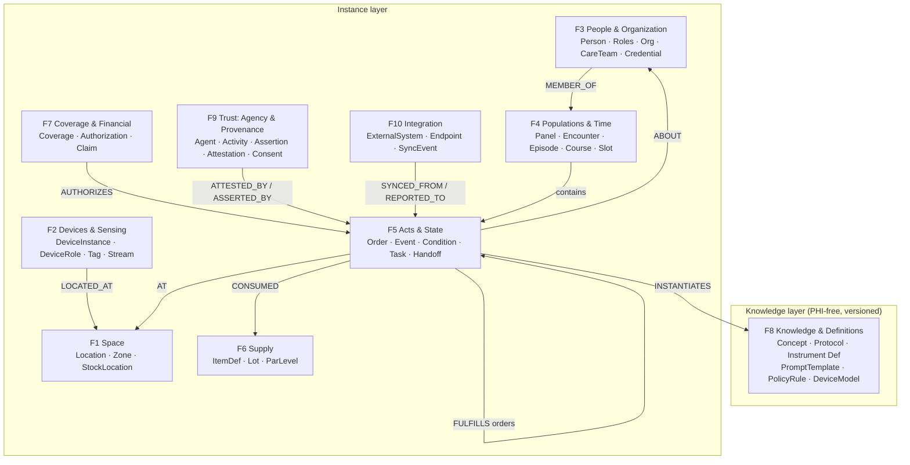

Healthcare runs on five kinds of facts that almost never share a data model: what was done
for the patient, who did it, where it happened, which devices sensed or acted, and which
software or person is accountable for each claim. Weft defines the node types, edge types,
and modeling rules that put all five into **one typed graph**, so a single query can cross
them.

- **10** node families, **70** node types, **77** typed edges (closed catalog, named inverses, one monitored escape hatch)
- **Built on** FHIR R4/R5, W3C PROV, SOSA/SSN, Brick, SNOMED CT, ISA-95, GS1 UDI, and OCEL 2.0

**[Read the specification](SPEC.html)** · [Download `weft.json`](weft.json) · [Changelog](CHANGELOG.html)

## Questions only a fused graph can answer

Each of these crosses domains that are normally stored in separate systems. In Weft, each
is one traversal over existing node and edge types.

| Question | Domains crossed |
|---|---|
| Which pumps from a recalled lot are in service right now, in which rooms, attached to which patients? | Devices, Space, Clinical |
| Which findings drafted by an AI model reached the EHR, under which prompt version, and which clinician signed each one? | AI provenance, Clinical, People |
| Which members of a care panel have a heat-sensitive condition or medication, and are on a campus under today's heat advisory? | Clinical, Space, External data |
| Do tonight's staff credentials match the acuity of the residents on each unit? | People, Clinical, Space |
| Which orders and results are still unsigned past their policy window? | Clinical, Trust |

The [specification](SPEC.html#9-validation--use-case-traversals) works through these and
other use cases edge by edge.

## The metagraph at a glance

One pattern recurs in every family: **Order** (intent) → **Event** (act) → **Attestation**
(accountability). Prescribe, administer, sign. Order, collect, verify. Plan, count, witness.
The same three nodes carry each of them, with different policy attached.

## What others model separately

| Domain | Where it is usually modeled alone |
|---|---|
| Clinical acts and state | EHR and patient-journey graphs (OMOP CDM, openEHR) |
| People and organization | HR and directory systems; partly in the EHR |
| Facility and space | Building ontologies (Brick, RealEstateCore, Project Haystack) |
| Devices and sensing | Sensor ontologies (W3C SSN/SOSA), UDI registries, ISA-95 |
| Trust and AI provenance | Provenance models (W3C PROV), audit logs, AI-transparency tags |

Biomedical knowledge graphs hold knowledge but no patients. EHR graphs hold patients but no
building. Building ontologies hold the building but no care. Every construct in Weft traces
to a recognized standard: **the primitives are precedented; the combination is the
contribution.**

## Design commitments

- **Two layers.** A versioned, PHI-free knowledge layer (concepts, protocols, policies,
  prompt templates) and a mutable instance layer (patients, encounters, devices, readings).
- **One event shape.** A vital sign, a room temperature, and a location ping are the same
  node shape: who sensed it, about what, which property, what value, when, and where.
- **Nothing is overwritten.** Roles, placements, and memberships carry validity intervals.
  Corrections supersede; they never delete.
- **Only humans attest.** Software agents and devices can assert. Only a credentialed human
  can attest, and the gap between the two is a single query.
- **Segmentation is in the schema.** Every node and edge carries a data class, so what flows
  to the EHR and what stays out of it is decided by the model, not by each application.
- **Clinical data round-trips to FHIR.** FHIR is the exchange format. Weft is the working
  graph that also holds what FHIR has no home for.

## Use it

Weft is licensed [CC BY 4.0](LICENSE): share and adapt it, including commercially, with
attribution. The schema is append-only. Node and edge types carry `since` and `deprecated`
markers and are never removed, so an implementation of an earlier version stays conforming.

Implementers extend Weft by authoring knowledge-layer artifacts (policy packs, protocols,
instruments, prompts), not by adding node types. To propose a change to the core catalog,
[open an issue](https://github.com/CleansheetLLC/weft-schema/issues).

## Cite

> *The Weft Schema, v0.1.1.* Cleansheet LLC, 2026. [https://doi.org/10.5281/zenodo.21806130](https://doi.org/10.5281/zenodo.21806130)

The DOI is a concept DOI and always resolves to the latest version. Machine-readable
citation metadata is in [`CITATION.cff`](CITATION.cff).

## Status

Version 0.1.1, August 2026. Stewarded by Cleansheet LLC.

This specification is published in part as a **defensive publication**: a public, dated,
enabling disclosure that places the five-domain fusion in the public record. The
specification and its machine projection are the open layer. Reference tooling, corpora,
and policy packs are not part of this publication.

*"Weft" is used by Cleansheet LLC as the name of this schema. Trademark rights in the name
are reserved and are not licensed under CC BY 4.0.*
